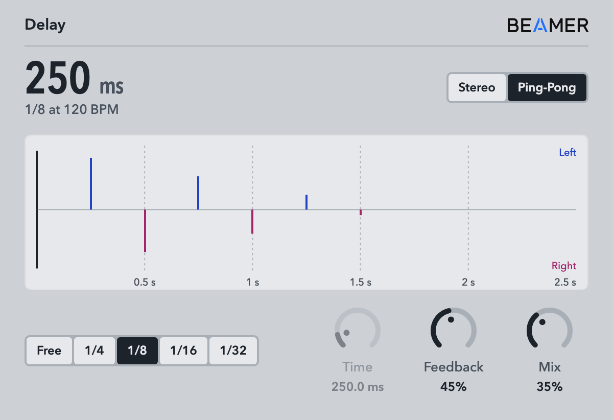
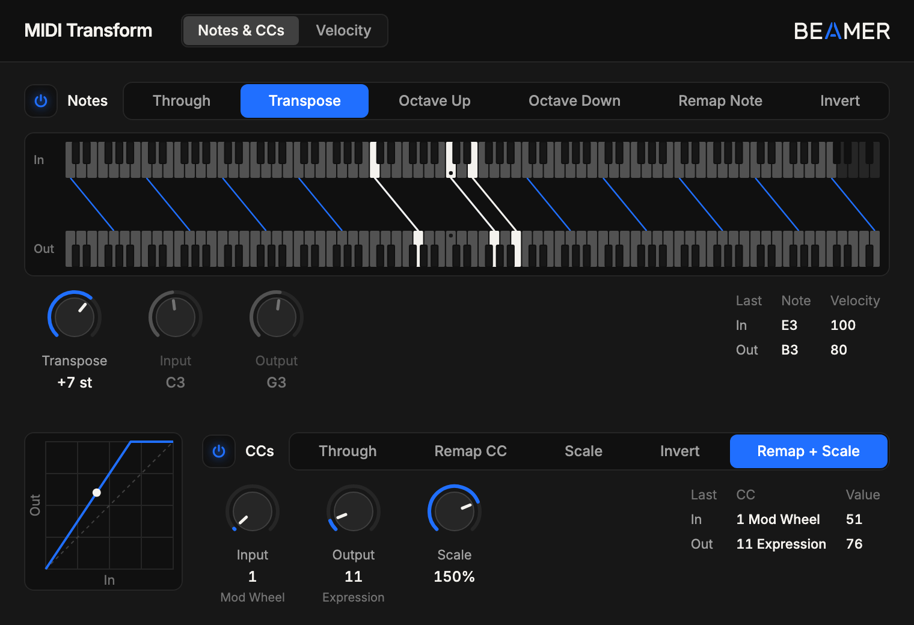

Beamer is a Rust framework for building Audio Unit (AU) and VST audio plugins.

Named after the beams connecting notes in sheet music and from Dutch where "beamer" means projector. Beamer projects your DSP logic onto AU (macOS) and VST3 (macOS; Windows planned) through modern web UI from a single codebase.

> [!NOTE]
> Beamer is pre-1.0 and under active development. Expect breaking changes between minor versions.

## Why Beamer?

**Built on Rust's guarantees.** Where most plugin frameworks use C++, Beamer uses Rust. Memory and threading bugs become compile-time errors, not runtime crashes.

**Macros do the heavy lifting.** `#[beamer::model]` generates host integration, state persistence, DAW automation and parameter access traits automatically. `#[beamer::export]` reads Config.toml at compile time to generate plugin metadata and entry points.

**Clean separation of concerns.** DSP code stays in safe Rust while the WebView architecture enables modern interfaces with HTML, CSS and JavaScript. Plugin configuration lives in Config.toml. Beamer bridges them together and handles plugin format complexity.

## Quick Start

You need a current stable Rust (from [rustup](https://rustup.rs)) and on macOS the Xcode Command Line Tools (`xcode-select --install`). [BUILDING.md](https://github.com/helpermedia/beamer/blob/main/docs/BUILDING.md#prerequisites) lists all prerequisites.

```bash
git clone https://github.com/helpermedia/beamer.git
cd beamer
cargo xtask bundle gain --auv3 --vst3 --release --install
```

This builds the gain example as an AUv3 and a VST3 and installs both. Rescan the plugins in your DAW and load **Beamer Gain**.

[GETTING_STARTED.md](https://github.com/helpermedia/beamer/blob/main/docs/GETTING_STARTED.md) takes it from there: a plugin of your own, its Rust side and an editor as a web page.

## Examples

### Effects

| Example&nbsp;&nbsp;&nbsp;&nbsp;&nbsp;&nbsp;&nbsp;&nbsp;&nbsp;&nbsp;&nbsp;&nbsp;&nbsp;&nbsp; | Description | Editor |
|---------|-------------|--------|
| **[gain](https://github.com/helpermedia/beamer/tree/main/examples/gain)** | Simple stereo gain plugin | - |
| **[compressor](https://github.com/helpermedia/beamer/tree/main/examples/compressor)** | Feed-forward compressor with sidechain input, a live transfer curve and meters from the audio thread | React |
| **[equalizer](https://github.com/helpermedia/beamer/tree/main/examples/equalizer)** | 3-band parametric EQ | - |
| **[delay](https://github.com/helpermedia/beamer/tree/main/examples/delay)** | Tempo-synced stereo delay with ping-pong mode | Plain HTML and JavaScript |
| **[tuner](https://github.com/helpermedia/beamer/tree/main/examples/tuner)** | Chromatic tuner from A0 to C8 with a needle, a strobe and a pitch detector on the audio thread | Svelte |

<p><a href="https://github.com/helpermedia/beamer/blob/main/examples/README.md#delay"></a></p>

### Instruments & MIDI

| Example&nbsp;&nbsp;&nbsp;&nbsp;&nbsp;&nbsp;&nbsp;&nbsp;&nbsp;&nbsp;&nbsp;&nbsp;&nbsp;&nbsp; | Description | Editor |
|---------|-------------|--------|
| **[synthesizer](https://github.com/helpermedia/beamer/tree/main/examples/synthesizer)** | 8-voice polyphonic synth with ADSR and filter | - |
| **[drum-synth](https://github.com/helpermedia/beamer/tree/main/examples/drum-synth)** | Stereo drum synthesizer whose drums can each go to an output of their own, with pads that play them and a mixer | Svelte |
| **[midi-transform](https://github.com/helpermedia/beamer/tree/main/examples/midi-transform)** | MIDI effect for note/CC transformation, with a note map that lights up the notes passing through | React |

<p><a href="https://github.com/helpermedia/beamer/blob/main/examples/README.md#midi-transform"></a></p>

See the [examples](https://github.com/helpermedia/beamer/tree/main/examples) for detailed documentation on each plugin.

## Features

- **Multi-format** - AU (macOS) and VST3 (macOS; Windows planned)
- **Declarative parameters** - `#[beamer::model]` with attributes for units, smoothing and more
- **Type-safe initialization** - `prepare()` lifecycle eliminates placeholder values and sample-rate bugs
- **Format-agnostic core** - Plugin logic is independent of format specifics
- **32-bit and 64-bit audio** - Native f64 support or automatic conversion for f32-only plugins
- **Multi-bus audio** - Main bus + auxiliary buses (sidechain, aux sends, multi-out) that hosts switch on and off
- **Complete MIDI support** - Full MIDI 1.0/2.0, MPE, Note Expression, SysEx
- **Real-time safe** - No heap allocations in the audio path
- **State persistence** - Automatic preset/state save and restore, also for data beyond parameters
- **Factory presets in code** - `Model::PRESETS` of typed `Preset::new(name, |m| ...)` closures, checked by the compiler
- **Sample-accurate automation** - Opt in with `sample_accurate_automation = true` in Config.toml
- **WebView editor** - Web-based plugin editors with WKWebView, bidirectional IPC, realtime-safe data from the audio thread (meters, streams) and packages for React and Svelte web UIs (macOS)

## Documentation

- [GETTING_STARTED.md](https://github.com/helpermedia/beamer/blob/main/docs/GETTING_STARTED.md) - A plugin of your own, from the Rust side to an editor
- [BUILDING.md](https://github.com/helpermedia/beamer/blob/main/docs/BUILDING.md) - Build, install and test plugins
- [ARCHITECTURE.md](https://github.com/helpermedia/beamer/blob/main/ARCHITECTURE.md) - Design decisions, threading model, guarantees
- [REFERENCE.md](https://github.com/helpermedia/beamer/blob/main/docs/REFERENCE.md) - API reference: configuration, parameters, traits, MIDI and format notes
- [WEBVIEW.md](https://github.com/helpermedia/beamer/blob/main/docs/WEBVIEW.md) - WebView editor, JavaScript API and the packages for web UIs (API, controls, React, Svelte)
- [EXAMPLE_COVERAGE.md](https://github.com/helpermedia/beamer/blob/main/docs/EXAMPLE_COVERAGE.md) - Example testing roadmap and feature coverage matrix

## Platform Support

| Platform | Status |
|----------|--------|
| macOS | Tested (arm64) |
| Windows | Planned - VST3 host scaffolding present, WebView UI not yet implemented |

Contributions for testing and fixes on Windows are welcome.

## Crates

| Crate&nbsp;&nbsp;&nbsp;&nbsp;&nbsp;&nbsp;&nbsp;&nbsp;&nbsp;&nbsp;&nbsp;&nbsp;&nbsp;&nbsp;&nbsp;&nbsp;&nbsp;&nbsp;&nbsp;&nbsp; | Description |
|-------|-------------|
| `beamer` | Main facade crate (re-exports everything) |
| `beamer-core` | Platform-agnostic traits and types |
| `beamer-macros` | `#[beamer::model]` and `#[beamer::group]` for the model, `#[beamer::handler]` for its answers to the web UI, `#[derive(EnumParameter)]` for enum parameters, `#[derive(TypeScript)]` for the web UI's types, `#[beamer::export]` for config and entry points |
| `beamer-utils` | Internal utilities (zero external dependencies) |
| `beamer-au` | AU wrapper (macOS) - AUv2 and AUv3 via shared C-ABI bridge |
| `beamer-vst3` | VST3 wrapper implementation |
| `beamer-webview` | WebView editor (WKWebView, IPC, asset serving) |

## License

MIT
